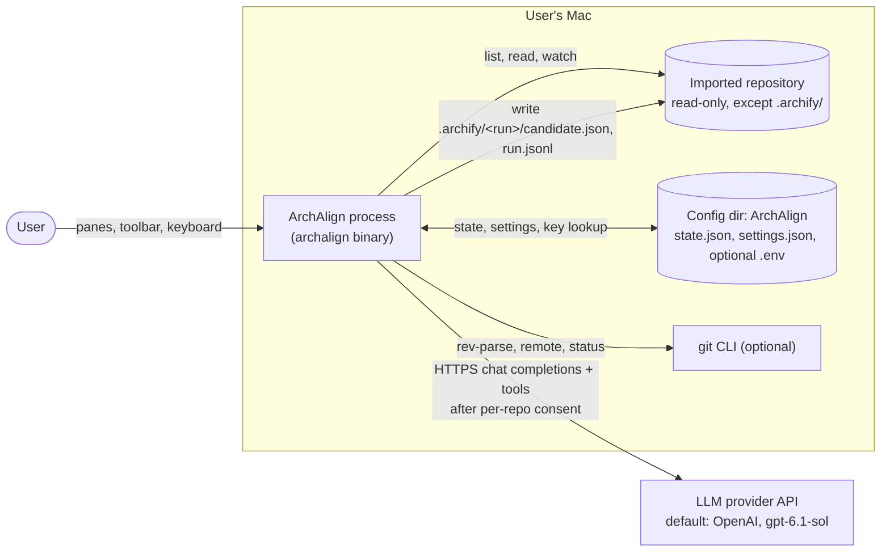
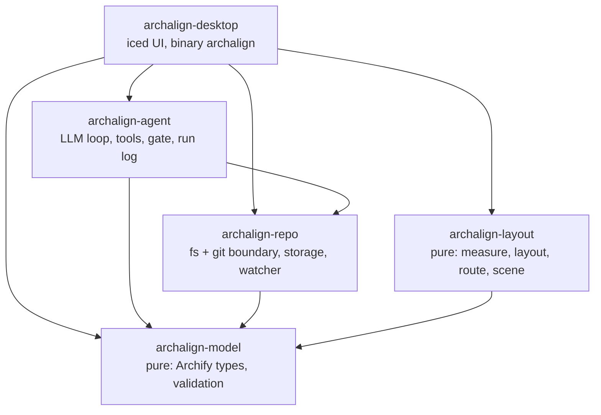
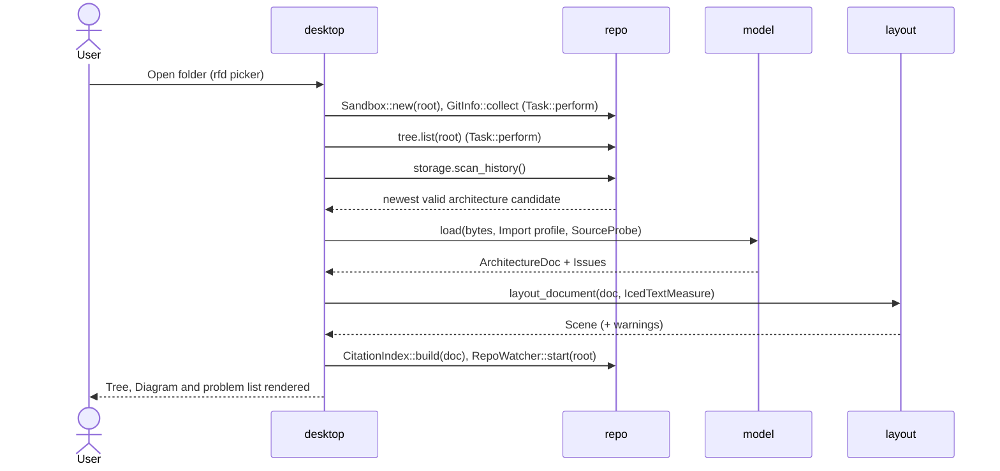
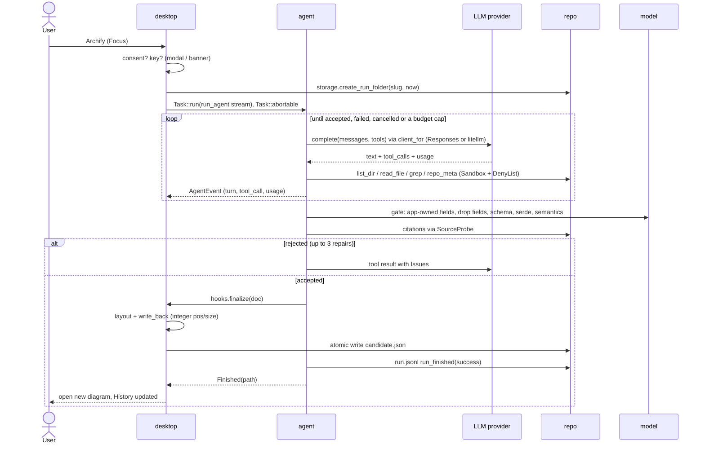
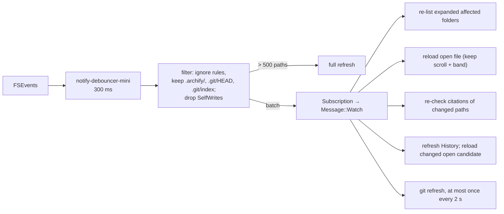
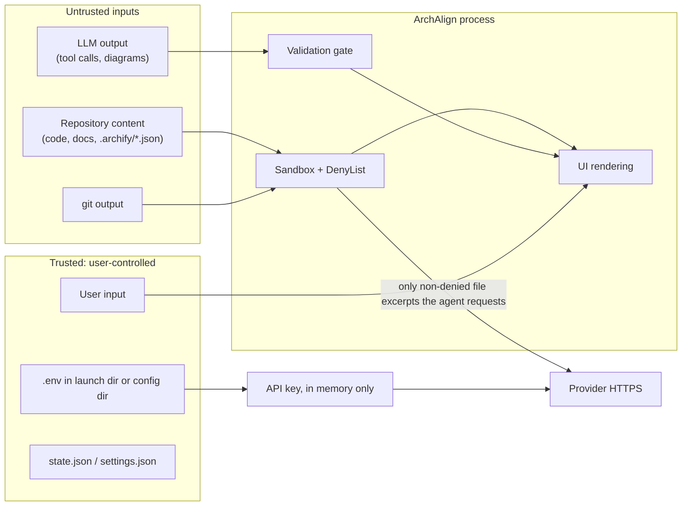

# ArchAlign architecture

- Status: Accepted, 2026-10-10
- Requirements: [spec.md](spec.md) · Decisions: [adr/](adr/README.md) · Dependencies: [libraries.md](libraries.md)

ArchAlign is a single-process native macOS app built with iced 0.14. It reads a local repository, can ask an LLM agent to produce an Archify architecture diagram of it, computes the diagram's layout, draws it on a canvas, and links every node back to the code it cites. This document describes the structure. The requirements and their IDs are in the spec.

## 1. System context



- The provider API is the only network peer ([0024](adr/0024-data-egress-consent-and-network-policy.md)).
- The only writes to the repository go to `.archify/` ([0015](adr/0015-diagram-storage-app-state-and-run-log.md)).
- Diagram files use Archify JSON v1, so the Archify Node CLI can render them and ArchAlign can open diagrams Archify made ([0012](adr/0012-archify-json-v1-canonical-format.md)).

## 2. Crate graph



Rules ([0003](adr/0003-cargo-workspace-and-crate-boundaries.md)):

- `archalign-model` and `archalign-layout` do no file or network I/O. Everything they need from outside comes in through traits (`SourceProbe`, `TextMeasure`).
- `archalign-agent` doesn't depend on `archalign-layout`. After the gate accepts a diagram, the desktop crate lays it out and saves it through a finalize hook (§4.2).
- Only `archalign-desktop` depends on iced.

| Crate | External dependencies ([libraries.md](libraries.md)) |
|---|---|
| model | serde, serde_json, jsonschema, thiserror |
| layout | dugong, serde, thiserror |
| repo | ignore, regex, notify-debouncer-mini, jiff, serde, serde_json, thiserror |
| agent | litellm-rust, reqwest 0.12, tokio, serde_json, thiserror |
| desktop | iced, syntect, rfd, directories, dotenvy, tokio, serde, serde_json, tracing-subscriber |
| all | tracing |

## 3. Crate responsibilities

The type names below are the intended public surface. The implementer may refine them, as long as the responsibilities and dependency rules stay as described.

### 3.1 archalign-model

**Purpose.** The canonical Archify v1 data model and every check that needs no file access.

**`ArchitectureDoc` and its parts.** `Meta`, `Component`, `Connection`, `Boundary`, `Card`, `SourceRef`, `Repository`, `Layout`, `Legend`, `GuidedView` and so on. Together they cover every property in the vendored `architecture.schema.json` and `common.schema.json`.
- Every struct uses `#[serde(deny_unknown_fields)]`.
- Fields the viewer ignores (views, translations, animation, icon, brand) are still modelled, so they survive a save.

**`DiagramDocument` and `DiagramType`.** `DiagramDocument` is an enum with a single `Architecture(ArchitectureDoc)` variant, plus detection of other Archify types for History. This is the seam for adding types later ([0013](adr/0013-architecture-diagrams-only-in-v1.md)).

**Schema validation.** The vendored schemas are embedded with `include_str!` and compiled once (a `LazyLock`) with `jsonschema`, with the common schema registered as a resource ([0014](adr/0014-schema-validation-with-vendored-archify-schemas.md)). The one surrogate-range pattern Rust regex can't compile is swapped in memory for an equivalent never-matching class (see `libraries.md`, `jsonschema`).

**Issues.** Every problem is an `Issue { severity, code, pointer, message }`. The same type feeds the UI banners, the problem list and the repair messages sent to the model.

**Validation profiles.** `Import` and `Submission` ([0027](adr/0027-submission-gate-and-repair-loop.md)).
- `document::load_architecture(bytes)`: JSON → type detection (non-architecture types fail with "Unsupported diagram type: `<type>`") → schema → serde → `checks::semantic(doc, Profile::Import)`. Returns `Loaded { doc, warnings }` or `LoadFailure { diagram_type, errors }`.
- `submission::check_submission(value, &AppOwned)`: steps 1–4 of the Submission profile; it returns the dropped-field pointers together with the document or the errors. Step 5 (citations) is run by the agent gate.
- Citation checks call a `SourceProbe` trait (`line_count`, `is_text`, `is_denied`) implemented by `archalign-repo`, so the model stays free of I/O.

**Editing helpers.**
- `apply_app_owned_fields` and `drop_model_supplied_fields` are used by the submission gate.
- `strip_geometry` is used by Re-layout ([0019](adr/0019-geometry-write-back-and-authored-layouts.md)).

**Serialization.** Pretty-printed with 2-space indentation, whole numbers written as integers (the `Num` newtype serializes whole `f64` values through `serialize_i64`). The guarantee is that load→save produces an equal JSON value.

### 3.2 archalign-layout

**Purpose.** Turn an `ArchitectureDoc` into a `Scene` of absolute geometry. Pure and deterministic.

**`TextMeasure`.** `fn measure(&self, text: &str, size_px: f64) -> Size` (all layout geometry is `f64`; the desktop converts to `f32` when drawing).
- The desktop implementation wraps `iced::advanced::graphics::text::Paragraph` with JetBrains Mono.
- Tests use `FixedAdvance` (0.6 em advance, 1.32 em line height, JetBrains Mono's metrics) ([0010](adr/0010-fonts-text-measurement-and-palette.md)).
- `measure::auto_node_size` stacks label (14 px), sublabel (12 px) and tag (11 px), adds 12/10 px padding, applies the 120×60 minimum and rounds up to whole pixels.

**`LayoutEngine`.** `fn place(&self, graph: &LayoutGraph) -> Result<Placement, LayoutError>` ([0031](adr/0031-dugong-placement-and-grid-astar-router.md)).
- `DugongEngine` builds a compound dagre graph: components are nodes, a component's innermost boundary is its parent, boundaries nest, ranks run left to right, self-loops are left out. Panics are caught.
- `GridFallbackEngine` is used when dugong fails or returns overlapping boxes.

**Modes (`mode`).** Authored when every component has `pos`, or a grid cell in grid mode (Archify's formula; `pos` wins; default size 120×60). Otherwise auto, with a `PartialPositions` warning when some positions were ignored (FR-LAY-01..03).

**Router (`route`).** One router for authored and auto layouts ([0031](adr/0031-dugong-placement-and-grid-astar-router.md)):
- sides from `fromSide`/`toSide` or relative position; ports spread along each side;
- A* over a sparse grid of inflated node edges (10 px margin), port/`via` lines and corridor midlines, with bend and reuse penalties, so routes never enter a node other than at their own ports;
- `via` points visited in order; self-loops as small rectangles on the right side;
- label anchor at the midpoint of the longest segment; arrowhead at the target.

**Boundaries (`boundaries`).** A nesting forest (smallest strict superset is the parent; equal member sets nest by index). Each rectangle encloses its members and nested boundaries, plus `pad` or Archify's 30/30/30/50 rule; the label anchor is at the top-left.

**`Scene` (`scene`).** `mode`, `nodes`, `boundaries` (outermost first) and `edges` (route polylines, label anchors, arrowheads), plus `bounds` and `warnings`. Elements keep their model indices and IDs, so the UI can map hits back to components and connections. `layout_document(doc, measure)` never mutates the document.

**`write_back(&mut ArchitectureDoc, &Scene)`.** Sets integer `pos`/`size` on every component.

### 3.3 archalign-repo

**Purpose.** The only crate that touches the filesystem or runs git.

**`Sandbox` (`sandbox`).** Holds the canonical root (`Arc<PathBuf>`) and resolves a `RelPath` (a normalized, `/`-separated newtype; `""` is the root; parsing rejects absolute paths, drive prefixes, `..`, backslashes and NUL) to a canonical absolute path.
- `resolve` canonicalizes and checks the root prefix, so symlinks that resolve outside the root are rejected; `is_outside_link` flags such links for the tree.
- UI reads, agent tools and citation checks all go through it ([FR-SEC-01](spec.md#711-fr-sec-security-and-privacy)). `SandboxError` messages are user-facing (shown in banners).

**`DenyList` (`deny`).** The fixed agent deny-list ([0025](adr/0025-agent-tool-sandbox-and-deny-list.md)): `.git/`, `.archify/`, `.env*` (except `.env.example`/`.env.sample`), key files, SSH keys and credential rc files, matched case-insensitively on any path segment. `is_denied_in` also checks the target of a symlink. Only the agent's tool set and `RepoProbe` apply it; the UI doesn't.

**`agent_fs`.** The agent's file-system views, all through `Sandbox` + `DenyList` + the ignore rules:
- `list_for_agent` (one level, folders first, sizes, at most `LIST_DIR_MAX` entries with an omitted count);
- `seed_tree` (depth 2, 400 entries, shallow levels first);
- `grep` (`regex` with a size limit; deterministic path order; skips binary and large files; capped matches, line length and time);
- `head_lines` (README and manifests for the seed).

**`tree`.** `list_dir(sandbox, dir, opts)`: one level, `ignore::WalkBuilder` with nested `.gitignore`, `.git/info/exclude` and the global gitignore; `.git` never listed; dotfiles only with `show_hidden`; folders (and links to folders) first, then files, case-insensitively; links are never followed and carry `outside_root`. `is_ignored` applies the same rules to one path (for the watcher).

**`text`.**
- `load_text`: size check from metadata (2 MB cap, `TooLarge`), binary sniffing (a NUL byte in the first 8 KB, `Binary`), lossy UTF-8 decoding with a `lossy` flag.
- `LineIndex` for line access; out-of-range calls return `""`, never panic.

**`git`.** `collect(root) -> GitStatus` (`Unavailable`, `NotARepo`, `Subfolder`, `Repo(GitInfo { head, origin, dirty })`), from `std::process::Command` with the fixed argument vectors of `read_argv` (each starting with `--no-optional-locks`), no shell, `GIT_TERMINAL_PROMPT=0`.
- Origin userinfo is stripped (`sanitize_origin`); `GitInfo::repository()` builds `meta.repository` (provider for HTTPS GitHub/Gitee, else `local-only`).
- A root that isn't the top of a work tree is `Subfolder` and counts as non-git ([0016](adr/0016-local-folder-import-and-git-metadata-via-cli.md)).

**`citations`.**
- `RepoProbe` implements `model::SourceProbe` over `Sandbox` and the `text` caps; the checks themselves live in `archalign-model::citations::check_citations` (FR-VAL-06/07).
- `CitationIndex::build(doc, issues)` maps file → citing nodes, folder → distinct cited files below it, and the set of files with broken citations; the desktop uses it for tree markers (FR-TREE-06) and reverse highlighting (FR-TREE-07).

**`storage`.**
- `scan_history` lists `.archify/*/candidate.json` newest first (timestamp suffix, then mtime) with a `Valid`/`Invalid`/`Unsupported` status; `newest_valid` picks the one to open on import (FR-IMP-03).
- `atomic_write`: temp file in the same folder, `sync_all`, rename.
- Run folders: `slugify(focus, repo name)` (at most 40 chars on a word boundary), `now_run_timestamp` (`jiff` local time, `YYYYMMDD-HHMMSS`), `create_run_folder` (creates `.archify/`, numbered suffix on collision) and `append_line` for `run.jsonl` (FR-STO-01/02).
- `SelfWrites` records (path, len, mtime) of the app's own writes (`atomic_write_tracked`) so the watcher can ignore them (FR-WAT-08, wired in M6).

**`watch`.** `RepoWatcher::start(sandbox, self_writes, show_hidden, on_batch)` wraps `notify-debouncer-mini` (300 ms, FSEvents, recursive on the canonical root); dropping it stops the watch ([0017](adr/0017-file-watching.md)).
- `classify` is the pure filter: drops paths outside the root; under `.git/` keeps only `HEAD`/`index` (as a `git` flag); always keeps `.archify/`; drops ignored paths (the tree's rules and `show_hidden`) and the app's own writes (`SelfWrites`). More than 500 remaining paths become `WatchBatch::Full`.
- `Changes` carries the sorted paths, their parent folders, and `archify`/`git` flags.
- `GitRefreshLimiter` spaces git refreshes at least 2 s apart and coalesces requests in between (FR-WAT-09).

### 3.4 archalign-agent

**Purpose.** Run one diagram-authoring conversation with an LLM, safely and within budget. No GUI.

**`LlmClient` (`llm`).** `fn complete(&self, TurnRequest) -> BoxFuture<Result<TurnResponse, LlmError>>` (boxed so the trait is object-safe; the desktop holds an `Arc<dyn LlmClient>`).
- `TurnResponse` carries the text, the typed `ToolCall`s, the usage and opaque `replay` items (OpenAI encrypted reasoning) that go back with the next turn.
- Tests use a scripted fake.

**`client_for(model, key, timeout)`** picks the adapter by provider:
- **`OpenAiResponsesClient` (`openai`)** for `openai/…`: `POST /v1/responses` with our reqwest 0.12 client (300 s timeout), `store: false`, encrypted reasoning replayed, real `Retry-After` header ([0034](adr/0034-openai-via-responses-api.md)).
- **`LiteLlmClient` (`litellm`)** for every other provider, the only module that touches litellm-rust ([0021](adr/0021-litellm-rust-behind-llm-client-trait.md)): `LiteLLM::completion` with our reqwest client; `tool_calls` parsed from the OpenAI-shaped value; `Retry-After` recovered from the error body ([0033](adr/0033-retry-after-from-error-bodies-for-litellm-providers.md)).
- Both take the key explicitly and never print it (`Debug` hides it).

**`retry`.** `complete_with_retry` retries 429, 5xx and timeouts up to 3 times (1/2/4 s or `Retry-After`), each attempt bounded by the per-request timeout, through an injectable `Sleeper` (FR-GEN-08).

**`ToolSet`.** `list_dir`, `read_file`, `grep`, `repo_meta` and `submit_diagram`, built over `Sandbox` plus `DenyList`, with their caps. It also supplies the OpenAI function schemas sent with every turn (FR-GEN-04).

**`prompt`.** The system prompt (`prompts/system.md`, embedded with `include_str!`) and the seed-message builder (FR-GEN-03).

**`gate`.** The `submit_diagram` pipeline:
1. app-owned fields;
2. dropped fields;
3. schema;
4. serde;
5. semantic checks;
6. citations through `SourceProbe`.

It returns accepted, or a list of `Issue`s ([0027](adr/0027-submission-gate-and-repair-loop.md)).

**`run`.** `run_agent(cfg, client, tools, finalize, sink, log, sleeper) -> RunOutcome`. This is the loop, and it enforces the budgets ([0028](adr/0028-agent-run-budgets.md)): turns and input tokens per turn, the wall clock as a `tokio::time::timeout` around the whole conversation, and the repair budget (the 4th rejection fails). Cancelling is dropping the future; `RunLog`'s `Drop` then records `cancelled`.
- It emits `AgentEvent`s through an `EventSink`.
- It writes `run.jsonl` through `RunLog`.
- On acceptance it calls the desktop-supplied `hooks.finalize(doc)`, which lays out and saves the diagram, then logs `run_finished`.

**`RunLog`.** Writes the events from the spec's Appendix A. It never writes file contents, tool output bodies or the key.

### 3.5 archalign-desktop

**Purpose.** The iced application and the only crate that knows about windows, input and pixels.

The crate is a library (`src/lib.rs`, so tests can drive `App`) plus the `archalign` binary (`src/main.rs`: tracing to stderr, then `archalign_desktop::run`).

**`App` (`app`)**, following iced's Elm architecture:
- **State:** `RepoSession` (`Sandbox`, `GitStatus`, history), `PaneLayout`, `TreeState`, `SourceState`, `DiagramState`, `RunState`, recents, Focus text, banners, theme, a `generation` counter (async results from a previous repo are dropped), and the git program (overridable for tests).
- **`Message`:** one enum. User actions are `Message::Action(Action)`; toolbar buttons and shortcuts send the same `Action` (FR-PANE-09).
- **Shortcuts:** `keyboard::listen()` delivers key presses no widget captured. `shortcut_action` maps them to an `Action`, disabled actions are dropped, and an `is_focused` check over the visible text fields runs before dispatch, so global shortcuts don't fire while typing (§9).
- **`Boot`:** last repo, recents, theme, `Settings`, consents, and test overrides for the git program, the key environment (`KeyEnv`) and the LLM factory (filled by `persist::boot_from_disk`).
- **Archify** (`App::archify`, FR-GEN-01): provider from the model prefix → key (`keys::resolve`) → consent (else the consent modal) → client from the `LlmFactory` → `create_run_folder` → `Task::run(agent_run::stream(prepared)).abortable()`. Each failure is a banner and no model call. `RunMsg` events update `RunState` and the run-log drawer; a 1 s `time::every` tick updates the elapsed time; Cancel/⌘. aborts the handle; success rescans History and opens the candidate.
- All file-system work runs in `Task::perform` + `spawn_blocking` (`ops`: `open_repo`, `list`, `read_file`, `load_diagram`); results come back as messages.

**Modules:**
- `view`: toolbar, Panels/History dropdown strips, welcome screen, `pane_grid` with title bars (name, context label, Maximize/Restore, Close), banners and the status bar;
- `panes`: `PaneKind`, `PaneLayout` (default configuration, drag/drop via `State::drop`, ratio clamping through pane_grid's own min-size arithmetic, reopen by splitting the largest pane);
- `tree`: `TreeState` (listed folders, expanded set, selection, pending reveal, citation markers) and its virtualized view;
- `source`: `SourceState`, citation band and out-of-range rules, `FileHighlighter` (syntect with parse-state checkpoints every 128 lines, highlighting only the window being built), virtualized view;
- `diagram`: `DiagramState` (content, camera, canvas size, selection, reach, reverse highlight, hover, finder, strip toggles) and the pane view: optional finder bar, a `stack` of the canvas and a pinned hover tooltip, and the detail strip (selection details with clickable sources and Upstream/Downstream, Problems, Cards);
  - `diagram::camera`: `canvas = diagram × zoom + pan`, zoom about a point clamped to 10–400 %, fit with 40 px padding;
  - `diagram::canvas`: `DiagramCanvas` implements `canvas::Program`. The static layer (boundaries, connections with arrowheads and labels, nodes with label/sublabel/tag and badges, legend) lives in a `canvas::Cache` inside the widget state and is cleared only when the scene version, theme, zoom or pan changes. The overlay (reach dimming, selection, reverse highlight, hover) is rebuilt each frame. The program hit-tests nodes and connections in diagram space and publishes `CanvasEvent`s (press/hit, unfocus, pan, ⌘/Ctrl-scroll zoom, hover, resize); modifiers come from `ModifiersChanged`;
  - `diagram::logic`: pure reach BFS (cycle-safe), legend rows, finder matching, badges from citation warnings, tooltip and source labels;
- `palette`: Archify's dark and light colors, and the iced themes built from them;
- `fonts`: bundled JetBrains Mono, `ensure_loaded`, and `IcedTextMeasure` (`Paragraph::with_text(…).min_bounds()` through the global font system, so it works on worker threads);
- `ids`: widget IDs used by the view and by tests;
- `virtual_list`: the shared window/offset arithmetic ([0009](adr/0009-custom-virtualized-source-viewer.md)). Until a scrollable reports its viewport, the pane's body size is used.

**Keyboard.** `event::listen_with` delivers every key press with its capture status. Diagram shortcuts (`+ - 0 F U D / ⌘F Esc`) apply only while the canvas has focus (set by a press inside it, cleared by a press outside) and only for uncaptured keys, so typing in a text field never triggers them. While the finder is open, ↑/↓ move and Esc closes it even though the field captured the key. ⌘/Ctrl+scroll zoom exists because iced has no pinch events ([0005](adr/0005-iced-native-gui-toolkit.md)).

**Re-layout** (`ops::relayout`): strip geometry → layout → `write_back` → `atomic_write` → reload through the Import profile.

**M5 modules:**
- `settings`: `Settings` (model, `reasoning_effort`, budgets, show hidden files) and `Consent` (repo root, provider, model, time);
- `keys`: `KeyEnv` (environment lookup, launch dir, config dir) and `resolve` (environment, then launch-directory `.env`, then config-dir `.env`, read with `dotenvy::from_path_iter` without touching the process environment ([0023](adr/0023-api-key-resolution.md))); `ApiKey`'s `Debug` is redacted;
- `agent_run`: `LlmSpec`/`LlmFactory` (`provider_factory` in production), `PreparedRun`, the `stream()` that runs `run_agent` on the tokio runtime and forwards events as `RunMsg`, `DesktopFinalize` (layout, `write_back` of integer `pos`/`size`, `atomic_write_tracked` of `candidate.json`), `event_line` for the drawer, and `repo_facts`;
- `view`: the consent modal (`modal_layer`: an `opaque` backdrop in a `stack`) and the run-log drawer at the bottom of the Diagram pane.

**M6 modules:**
- `persist`: `state.json`/`settings.json` in `directories::ProjectDirs` (`ArchAlign`), written atomically through `storage::atomic_write`; `LayoutNode`/`PanesState`, a serde mirror of the pane grid because `pane_grid::Configuration` has no serde support ([0006](adr/0006-three-pane-grid-layout.md)); lenient loading (an invalid layout falls back alone; a bad file falls back to defaults with a banner); `boot_from_disk` builds the launch `Boot`. `App::update` compares `app_state()` with the last saved state after every message and saves at most once per second.
- `watch`: the watcher `Subscription::run_with(WatchKey, stream)`, keyed by repo generation, root and "show hidden files". The stream starts a `RepoWatcher` and sends `WatchStarted`/`WatchFailed`, then one `Watch` message per batch.
- `view`: the History strip (title, timestamp, status; click opens) and the Settings modal (model, `reasoning_effort`, budgets, show hidden files, key source, consents with Revoke).
- Watch handling in `App`: re-list affected expanded folders, reload the open file keeping scroll and band ("File deleted" banner), re-check citations (`ops::citation_issues` → `DiagramState::replace_citation_issues`, keeping camera and selection), rescan History, reload an externally changed open diagram (keeping the last good one if invalid), and rate-limited git refreshes; `Full` and ⌘R run all of them (`refresh_all`).

**Subscriptions:** keyboard shortcuts, window resizes, the 1 s run tick, and the repo watcher.

**Tests.** `tests/common/` holds the UI harness ([0032](adr/0032-ui-test-harness-on-iced-test-parts.md)): `iced_test`'s headless renderer and a persisted `UserInterface`, with the app's real tasks executed. Streams that stall (an agent run waiting on the model) stay pending and are pumped by `pump`/`wait_until`, so long-running tasks and Cancel can be tested. Tests never read the real environment or `.env` and never reach the network unless a test injects a key environment and an LLM factory. `tests/live.rs` is the opt-in live run (`ARCHALIGN_LIVE=1`, `#[ignore]`). Screenshots go to `target/smoke/`.

## 4. Main flows

### 4.1 Opening a repository



Opening never writes to disk (FR-LAY-08). A diagram with authored geometry is drawn as stored. One without geometry is laid out in memory only.

### 4.2 An archify run



- **Cancel** aborts the task handle. The dropped future cancels the in-flight HTTP request. `run.jsonl` ends with `cancelled` and no candidate is written ([0008](adr/0008-async-model-tokio-and-iced-tasks.md)).
- **Budget caps** end the run as `failed`, and the log names the cap.

### 4.3 Navigation

- **Node click.**
  1. The canvas hit test returns the component ID, and `DiagramState` selects it.
  2. The desktop resolves `sources[0]` through `Sandbox`, loads the file off the UI thread, and builds the `LineIndex`.
  3. `SourceState` scrolls with `scroll_to` and paints the band over `line..=end_line`.
  4. `TreeState` expands the file's ancestors and reveals it.
- **Tree selection.** A tree selection looks the file up in `CitationIndex` and highlights the citing nodes in the canvas overlay layer.
- **Edge click and reach.** Both work on the `Scene` and the document's directed connection graph only. Reach is a breadth-first traversal that tolerates cycles.

### 4.4 File changes



If the watcher can't start, the status bar shows "Manual refresh only". ⌘R runs the same refresh paths manually.

## 5. Concurrency

| Context | What runs there |
|---|---|
| UI thread (iced) | `update`, `view`, canvas `draw` (static layer cached) |
| tokio runtime (iced `tokio` executor) | The agent run stream, HTTP calls, timers (retry backoff, wall clock) |
| `spawn_blocking` | Directory listing, file reads and line indexing, syntect warm-up, citation checks, git commands, `grep` |
| Debouncer thread (notify) | Filesystem events, sent over a channel into a `Subscription` |

- No mutable state is shared across threads. Messages carry owned data.
- `Sandbox` and `DenyList` are cheap to clone (they hold an `Arc` root).
- iced's text measurement uses its global font system, so finalize-time layout can run on a worker thread.
- Cancelling drops the run future. Work already inside `spawn_blocking` stops at its own caps (`grep` ≤ 5 s).

## 6. On-disk layout

### 6.1 Project repository (this workspace)

```text
Cargo.toml                 workspace; [workspace.dependencies]; rust-version 1.95
rust-toolchain.toml        stable channel
THIRD_PARTY_NOTICES.md     Archify (MIT, upstream 27f78a2), JetBrains Mono (OFL-1.1)
crates/
  archalign-model/         src/, schemas/{architecture,common}.schema.json
  archalign-layout/        src/
  archalign-repo/          src/
  archalign-agent/         src/, prompts/system.md
  archalign-desktop/       src/, assets/fonts/JetBrainsMono-*.ttf
fixtures/archify/          vendored *.architecture.json
docs/                      spec, architecture, libraries, progress, adr/
```

`archify-src/`, `.smoke_repo/`, `.archify/`, `.env` and `/target` are gitignored. `archify-src/` is reference material only ([0004](adr/0004-name-attribution-and-vendored-archify-material.md)).

### 6.2 Imported repository

```text
<repo>/.archify/architecture-<slug>-<YYYYMMDD-HHMMSS>/
  candidate.json   on success: Archify v1 with integer pos/size; meta.output points at a never-written <slug>.html
  run.jsonl        always: run events (spec Appendix A)
```

### 6.3 Per user

```text
<OS config dir for "ArchAlign">/
  state.json       window, pane layout, theme, recent repos, consents
  settings.json    model, reasoning_effort, budgets, show hidden files
  .env             optional third place to look up the API key
```

## 7. Trust boundaries



| Threat | Control |
|---|---|
| Path traversal via tool arguments or a crafted `candidate.json` | `Sandbox` confinement for every read (FR-SEC-01) |
| Secrets sent to the provider | Deny-list, the repo's `.env` is never read, consent dialog (FR-SEC-02..04) |
| Prompt injection in repository text | Tools are read-only and confined; there are no shell, write or network tools; the worst case is a wrong diagram or wasted budget ([0025](adr/0025-agent-tool-sandbox-and-deny-list.md)) |
| Malicious or oversized model output | Schema and semantic gate, a 3-repair limit, budgets, the 24 KB tool-result cap |
| Hostile regex in `grep` | `regex` crate, linear-time matching; 5 s and 1 MB caps |
| Key leakage | The key lives in memory only; it's never logged, displayed or written to `run.jsonl` (FR-SEC-04, FR-SEC-06) |
| Credentials in the origin URL | Userinfo stripped before storing or sending (FR-SEC-07) |
| Shell injection through git | Fixed argument vectors, no shell (FR-SEC-08) |

## 8. Errors

- **Library crates** return `thiserror` enums at their boundaries (`SandboxError`, `StorageError`, `LayoutError`, `LlmError`, `RunError`). Validation results come back as `Vec<Issue>`, not errors.
- **The desktop crate** maps every error to a pane banner plus a status-bar message (FR-PANE-11).
- **No panics.** Repository content, diagram files and state files never cause a panic. Corrupt `state.json` or `settings.json` falls back to defaults.

## 9. Extension points

| Seam | Today | Planned or possible |
|---|---|---|
| `DiagramDocument` + type detection | Architecture only | Workflow, sequence, dataflow, lifecycle ([0013](adr/0013-architecture-diagrams-only-in-v1.md)) |
| `LayoutEngine` | dugong (dagre), grid fallback | ELK via `merman-layout-elk`, through a superseding ADR ([0031](adr/0031-dugong-placement-and-grid-astar-router.md)) |
| `LlmClient` | litellm-rust 0.3.0 | `async-openai` fallback ([0021](adr/0021-litellm-rust-behind-llm-client-trait.md)) |
| Model string | `openai/gpt-6.1-sol` | Any litellm `provider/model` with its own key variable ([0022](adr/0022-default-model-gpt-6-1-sol.md)) |
| `TextMeasure` | iced paragraph with JetBrains Mono | Other fonts, without touching layout code |

## 10. Testing seams

| Seam | Used for |
|---|---|
| Fixed-advance `TextMeasure` | Deterministic `insta` layout snapshots and `proptest` invariants |
| Scripted fake `LlmClient` | Offline agent-loop tests: repair, caps, cancel, malformed tool calls |
| `Sandbox` over `tempfile` repos | Confinement, deny-list, ignore rules, git metadata, watcher filtering |
| `iced_test::Simulator` | Pane operations, node-click navigation (by `Point`), tree reverse highlight, toolbar and shortcuts |
| `ARCHALIGN_LIVE=1` | Live runs against `.smoke_repo/*` and a copy of `archify-src/` ([0029](adr/0029-testing-strategy-and-live-smoke-runs.md)) |
